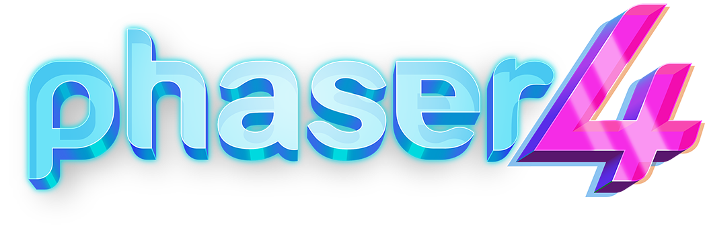
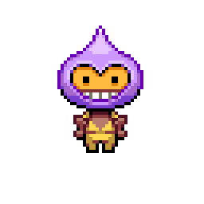

# Phaser - HTML5 Game Framework



[](https://discord.gg/phaser)


Phaser is a fast, free, and fun open source HTML5 game framework that offers WebGL and Canvas rendering across desktop and mobile web browsers and has been actively developed for over 13 years.

Games can be built for the web, or as YouTube Playables, Discord Activities, Reddit games, Twitch Overlays or compiled to iOS, Android, Steam and native apps using 3rd party tools. You can use JavaScript or TypeScript for development. Phaser supports over 40 different front-end frameworks including React and Vue.

Phaser is commercially developed and maintained by **Phaser Studio Inc** along with our fantastic open source community. As a result of rapid support, and a developer friendly API, Phaser is currently one of the [most starred](https://github.com/collections/javascript-game-engines) game frameworks on GitHub.

Interested in learning more? Click the image below to watch our intro video.

[](https://www.youtube.com/watch?v=XLhi9IW0rxg)

---

## Installing Phaser from NPM

Install via [npm](https://www.npmjs.com/package/phaser):

```bash
npm install phaser
```

Then import it in your project:

```js
import Phaser from 'phaser';
```

## Using Phaser from a CDN

[Phaser is on jsDelivr](https://www.jsdelivr.com/package/npm/phaser) which is a "super-fast CDN for developers". Include _either_ of the following in your html:

```html
<script src="//cdn.jsdelivr.net/npm/phaser@4.2.1/dist/phaser.js"></script>
<script src="//cdn.jsdelivr.net/npm/phaser@4.2.1/dist/phaser.min.js"></script>
```

It is also available from Cloudflare's [cdnjs](https://cdnjs.com/libraries/phaser):

```html
<script src="https://cdnjs.cloudflare.com/ajax/libs/phaser/4.2.1/phaser.js"></script>
<script src="https://cdnjs.cloudflare.com/ajax/libs/phaser/4.2.1/phaser.min.js"></script>
```

## Create Phaser Game App

The easiest way to get started quickly with Phaser is our `create-phaser-game` app. This CLI tool presents an interactive selection of official project templates and demo games. Issue the command, answer some questions and the app will download and configure the right package for you.

```bash
npm create @phaserjs/game@latest
npx @phaserjs/create-game@latest
yarn create @phaserjs/game
pnpm create @phaserjs/game@latest
bun create @phaserjs/game@latest
```

We support Vue.js, React, Angular, Next.js, SolidJS, Svelte and Remix with Vite, Rollup, Parcel, Webpack, ESBuild, Import Map and Bun. Most come in both JavaScript and TypeScript versions.

[View the create game app tutorial](https://phaser.io/tutorials/create-game-app).

## How Big is Phaser?

Don't be alarmed if you look at `phaser.js` and see a file over 8 MB. Over 84% of that is inline documentation - JSDoc comments, type annotations, and detailed method descriptions that power the TypeScript definitions and API docs. It's there for your IDE, not for your players.

The minified build, `phaser.min.js`, strips all of that out and comes in at **345 KB** with standard gzip web server compression. This is the full version, with every feature included, but is still smaller than most texture images. You can reduce it further still by tweaking the build settings to exclude features your game doesn't need.

| Build | Raw Size | Compressed (gzip) |
| ----- | -------- | ------------------ |
| `phaser.js` (with docs) | 8.23 MB | - |
| `phaser.min.js` (full) | 1.29 MB | 345 KB |
| `phaser-arcade.min.js` | 1.18 MB | 313 KB |

### Why Phaser?

- **Battle-tested** - Over a decade of active development. Tens of thousands of games shipped. A huge community of developers who've seen it all.
- **Truly cross-platform** - One codebase runs on desktop browsers, mobile browsers, and can be wrapped for native app stores, Steam, YouTube Playables, Discord Activities, and more.
- **Developer-friendly API** - Scene-based architecture, a comprehensive loader, built-in physics (Arcade and Matter.js), animation system, input handling, cameras, tilemaps, particles, tweens, and much more - all with clear, consistent APIs.
- **Framework agnostic** - Works with React, Vue, Angular, Svelte, or plain JavaScript and TypeScript. Use whatever tools you prefer.
- **Massive ecosystem** - Over 2,000 code examples. Extensive API documentation. Active Discord and forums. First-class TypeScript definitions.
- **AI-ready** - Phaser's API is well understood by every major frontier LLM. This repository includes a comprehensive set of [AI agent skills](skills/) that give coding agents deep knowledge of every Phaser subsystem, making it the ideal framework for AI-assisted game development.

## What's New in Phaser 4

Phaser 4 is a major release built on a brand-new WebGL renderer. The entire rendering pipeline from v3 has been replaced with a modern, node-based architecture that manages WebGL state properly, handles context loss gracefully, and is significantly faster. If you've built games with Phaser 3, the public API is mostly familiar - but under the hood, everything has changed for the better.

Here are the headline features. For the full picture, see the [v4.0 Changelog](changelog/v4/4.0/CHANGELOG-v4.0.0.md) and [Migration Guide](changelog/v4/4.0/MIGRATION-GUIDE.md).

### New Render Node Architecture

The v3 pipeline system has been replaced with a clean, node-based renderer. Each render node handles a single task, WebGL state is fully managed, and context restoration is built in. The result is a renderer that's faster, more reliable, and much easier to extend with custom rendering logic. Quads now use index buffers, reducing vertex upload costs by a third. Multi-texture batching is smarter, avoiding unnecessary batch breaks on mobile. And the whole system uses just-in-time rendering - nothing hits the GPU until it absolutely has to.

### Unified Filter System

FX and Masks from v3 have been unified into a single, powerful **Filter** system. Filters can be applied to any game object or camera - no more restrictions on which objects support effects. Every filter takes an input image and produces an output, usually via a single shader, so they're all mutually compatible.

v4 ships with a huge library of built-in filters: Blur, Glow, Shadow, Pixelate, ColorMatrix, Bloom, Vignette, Wipe, and many more. New additions include **ImageLight** for realistic image-based lighting, **Blocky** for pixel-art-friendly pixelation, **GradientMap** for palette-swap effects, **Quantize** for retro dithered palettes, **Key** for chroma keying, **NormalTools** for normal map manipulation, and **Blend** which brings all 27 Canvas blend modes to WebGL.

Masks are now a filter too, more powerful than ever. A `Container` full of filtered, masked objects can itself be used as a mask source.

### SpriteGPULayer - Render a Million Sprites

`SpriteGPULayer` is a new game object designed to render massive numbers of sprites. Where standard Phaser rendering handles tens of thousands of sprites comfortably, SpriteGPULayer handles **a million or more**, up to 100x faster.

It works by storing all member data in a static GPU buffer and rendering everything in a single draw call, skipping the per-frame CPU-to-GPU upload that's normally the main bottleneck. Members aren't just static, either - each one supports GPU-driven animations on position, rotation, scale, alpha, tint, and frame, with a full set of easing functions. Per-member scroll factors enable parallax backgrounds, and non-looping mode supports one-off particle effects. It's perfect for bringing complex, animated backgrounds to life without touching your frame budget.

### TilemapGPULayer - Render Millions of Tiles

`TilemapGPULayer` renders an entire tilemap layer as a single quad. The shader cost is per-pixel, not per-tile, so it can display up to 4096 x 4096 tiles with no performance penalty for tile count. It also produces perfect texture filtering across tile boundaries - no seams, no bleeding. If you need large maps on screen at once, especially on mobile, this is the way to go.

### Overhauled Tint System

Tint has been reworked with color and mode as separate concerns. Six tint modes are available: `MULTIPLY`, `FILL`, `ADD`, `SCREEN`, `OVERLAY`, and `HARD_LIGHT`. The new `setTintMode()` method gives you explicit control, and BitmapText tinting finally works correctly.

### New Game Objects

- **Gradient** - Render linear, radial, conic, and bilinear color gradients with dithering support, powered by the new `ColorBand` and `ColorRamp` classes.
- **Noise, NoiseCell (2D/3D/4D), NoiseSimplex (2D/3D)** - Generate and animate cellular noise, simplex noise, and random static on the GPU, with normal map output for use in lighting and effects.
- **CaptureFrame** - Snapshot the current framebuffer mid-render for post-processing tricks.
- **Stamp** - Render a camera-independent quad, useful for DynamicTexture operations.

### Improved Lighting

Lighting is now as simple as `sprite.setLighting(true)` - no pipeline juggling required. Objects can cast self-shadows based on their own texture, lights have an explicit `z` height value, and lighting works across most game objects including BitmapText, Particles, TileSprite, and both tilemap layer types.

### Shader and TileSprite Improvements

The `Shader` game object has been rewritten with a cleaner config-based API (`ShaderQuadConfig`), and GLSL loading now uses standard `#pragma` directives that work with syntax checkers. `TileSprite` has been rebuilt with a new shader that supports texture atlas frames and tile rotation - no more whole-texture-only limitation.

---

## AI-Assisted Game Development

Phaser has been part of the training data for every major frontier LLM. Models from Anthropic, OpenAI, Google, and others understand the Phaser API deeply and can generate game code, debug rendering issues, set up physics, and build scene structures out of the box. Tools like Claude Code, Cursor, Codex, Antigravity, and GitHub Copilot can scaffold entire Phaser games and implement features from natural language descriptions.

### AI Agent Skills

This repository includes a comprehensive set of [AI agent skills](skills/) covering every major Phaser subsystem - scenes, physics, input, animations, tilemaps, tweens, particles, cameras, and much more. Point your AI coding agent at the `skills/` folder and it will understand Phaser 4's architecture, APIs, patterns, and gotchas in depth. Tell it to create a game and it will know the right way to structure scenes, load assets, set up physics, and handle input - all using idiomatic Phaser 4 code.

---

## Phaser TypeScript Definitions

Full TypeScript definitions can be found inside the [types folder](https://github.com/phaserjs/phaser/tree/master/types). They are also referenced in the `types` entry in `package.json`, meaning modern editors such as VSCode will detect them automatically.

Depending on your project, you may need to add the following to your `tsconfig.json` file:

```json
"lib": ["es6", "dom", "dom.iterable", "scripthost"],
"typeRoots": ["./node_modules/phaser/types"],
"types": ["Phaser"]
```

## API Documentation

Read our full API Documentation at https://docs.phaser.io/. Use the links at the top of the page to navigate the namespaces, classes, events and Game Objects and also to use the search box.

We maintain documentation for the most recent versions of Phaser on this site.

## Getting Started

We recommend the following to begin your journey:

* [Getting Started with Phaser](https://phaser.io/tutorials/getting-started-phaser3) (useful if you are completely new to Phaser)
* [Making your first Phaser Game](https://phaser.io/tutorials/making-your-first-phaser-3-game)
* Download our Free 500 page book [Phaser by Example](https://phaser.io/news/2024/04/phaser-by-example-book).
* Plus, there are [over 700 Phaser tutorials](https://phaser.io/learn) listed on our website.

New tutorials are being published every week, so check our site for more.

## Source Code Examples

We have created hundreds of examples and they are all available with full source code and assets.

Browse our [Phaser Examples site](https://phaser.io/examples).

## Phaser Sandbox

The Phaser Sandbox is a fully-configured online editor, fully updated for Phaser 4, ready to go direct in your desktop browser. It's loaded with the latest version of Phaser and packed full of handy features. [Register for a free Phaser account](https://phaser.io/register) to create and save your own sandbox entries. Or view one [just like this](https://phaser.io/sandbox/XyqPcjNr).

## Phaser Plugins

Super community member RexRainbow has been publishing Phaser content for years, compiling an impressive catalogue of plugins that all Phaser developers should be aware of.

You'll find [Phaser Plugins](https://rexrainbow.github.io/phaser3-rex-notes/docs/site/index.html#list-of-my-plugins) that extend the framework with features such as UI controls, text input boxes, Firebase support, Finite State Machines and lots more. His set of [Phaser Notes](https://rexrainbow.github.io/phaser3-rex-notes/docs/site/index.html) are also invaluable reading.

## Migrating from Phaser 3

Phaser 4 keeps most of the public API you know, but there are important breaking changes - the renderer, tint system, FX/Masks, Shader API, lighting, and several removed classes (Point, Mesh, BitmapMask) all need attention. We've written a detailed [Migration Guide](changelog/v4/4.0/MIGRATION-GUIDE.md) with a checklist to walk you through it.

We've also included a dedicated [v3 to v4 migration skill](skills/v3-to-v4-migration/SKILL.md) in this repository. Point your AI coding agent at it and tell it to migrate your Phaser 3 game - it understands every breaking change and knows the exact v4 replacements.

## Change Log

We meticulously keep track of new features, updates and bug fixes in our change logs. Each version of Phaser has its own change log:

* [v4.2.1 Change Log](changelog/v4/4.2.1/CHANGELOG-v4.2.1.md)
* [v4.2.0 Change Log](changelog/v4/4.2/CHANGELOG-v4.2.0.md)
* [v4.1.0 Change Log](changelog/v4/4.1/CHANGELOG-v4.1.0.md)
* [v4.0.0 Change Log](changelog/v4/4.0/CHANGELOG-v4.0.0.md)
* [All Phaser Change Logs](CHANGELOG.md)

## Have fun!

Grab the source and join the fun!

Phaser wouldn't have been possible without the fantastic support of the community. Thank you to everyone who supports our work, who shares our belief in the future of HTML5 gaming, and Phaser's role in that.

Happy coding everyone!

Cheers,

[Rich](mailto:rich@phaser.io) and the whole team at Phaser Studio



**Visit** the [Phaser website](https://phaser.io)<br />
**Play** some [amazing games](https://phaser.io/games)<br />
**Learn** By browsing our [API Docs](https://docs.phaser.io) or [Support Forum](https://phaser.discourse.group/)<br />
**AI Skills** Point your AI agent at our [Phaser Skills](skills/) for deep framework knowledge<br />
**Code Examples?** We've over 2000 [Examples](https://phaser.io/examples) to learn from<br />
**Read** the weekly [Phaser World](https://phaser.world) Newsletter<br />
**Be Social:** Join us on [Discord](https://discord.com/invite/phaser) and [Reddit](https://www.reddit.com/r/phaser/) or follow us on [Twitter](https://twitter.com/phaser_)<br />

Powered by coffee, anime, pixels and love.

The Phaser logo and characters are &copy; 2011 - 2026 Phaser Studio Inc.

All rights reserved.

"Above all, video games are meant to be just one thing: fun. Fun for everyone." - Satoru Iwata


## 🌐 Web Resources & Interactive Index
- [SKYSCRAPER TO THE SKY](https://theskillquest.pages.dev/skyscraper-to-the-sky.html)
- [INDEX21](https://themindplay.github.io/index21.html)
- [ENERGY SUPERMAN 3D](https://learnquester.github.io/energy-superman-3d.html)
- [MERGE BRAINROT](https://themindzone.pages.dev/merge-brainrot.html)
- [CATEGORY WAR137](https://themindzone.pages.dev/category-war137.html)
- [COOKING WORLD REBORN](https://themindzone.pages.dev/cooking-world-reborn.html)
- [CATEGORY MAHJONG 3](https://iskillquest.pages.dev/category-mahjong-3.html)
- [INDEX20](https://thelearnquesters.pages.dev/index20.html)
- [CATEGORY FREE RAGDOLL GAMES](https://themindplays.pages.dev/category-free-ragdoll-games.html)
- [CATEGORY BOXING](https://iskillquest.pages.dev/category-boxing.html)
- [HOLE BATTLEIO](https://studyplayings.pages.dev/hole-battleio.html)
- [CATEGORY SANDBOX40](https://themindzone.pages.dev/category-sandbox40.html)
- [CATEGORY ADVENTURE 2](https://learnquester.github.io/category-adventure-2.html)
- [CATEGORY BOOKMARKLETS](https://iskillquest.pages.dev/category-bookmarklets.html)
- [CATEGORY TOOLS](https://thelearnquester.web.app/category-tools.html)
- [CATEGORY SIDE SCROLLING184](https://learnquesters.pages.dev/category-side-scrolling184.html)
- [CATEGORY SNAKE](https://themindzone.pages.dev/category-snake.html)
- [SHINY JEWELS](https://learnquesters.pages.dev/shiny-jewels.html)
- [ZOMBIE SIEGEIO](https://themindplaying.web.app/zombie-siegeio.html)
- [BLOCK PUZZLE KING](https://themindskillplayplay.pages.dev/block-puzzle-king.html)
- [MINICRAFT CHEF CAKE WARS](https://thelearnquester.web.app/minicraft-chef-cake-wars.html)
- [CATEGORY BIKE63](https://skillplay.github.io/category-bike63.html)
- [CATEGORY DRESS UP97](https://thequizzone.pages.dev/category-dress-up97.html)
- [CATEGORY DESTROY256](https://thelearnquesters.pages.dev/category-destroy256.html)
- [TERMS](https://thcskq.github.io/terms.html)
- [CATEGORY TOWER DEFENSE GAME](https://themindzone.pages.dev/category-tower-defense-game.html)
- [GEOMETRY DASH MAZE MAPS V2](https://themindplay.github.io/geometry-dash-maze-maps-v2.html)
- [FASHION BATTLE FOR SURVIVAL](https://themindplay.pages.dev/fashion-battle-for-survival.html)
- [TRIANGLES](https://themindplaying.web.app/triangles.html)
- [PRINXY WINTERELLA](https://thelearnquesters.pages.dev/prinxy-winterella.html)
- [DYNAMONS CONNECT](https://learnquester.pages.dev/dynamons-connect.html)
- [CATEGORY PUZZLE 8](https://themindzone.pages.dev/category-puzzle-8.html)
- [PHYSICS BOX 2](https://studyplayings.pages.dev/physics-box-2.html)
- [BARRY PRISON HIDE AND SEEK](https://themindplay.github.io/barry-prison-hide-and-seek.html)
- [SLINGSHOT MASTER](https://themindplay.pages.dev/slingshot-master.html)
- [FOOD SORT 3D](https://themindplays.pages.dev/food-sort-3d.html)
- [TURBO RACE](https://themindzone.pages.dev/turbo-race.html)
- [CATEGORY BOARDGAMES](https://themindplays.pages.dev/category-boardgames.html)
- [CATEGORY FPS174](https://thelearnquester.web.app/category-fps174.html)
- [CATEGORY CUTE](https://themindplays.pages.dev/category-cute.html)
- [MEME WARS](https://thelearnquester.web.app/meme-wars.html)
- [CATEGORY WATER39](https://themindzone.pages.dev/category-water39.html)
- [CATEGORY DESTROY256](https://themindplays.pages.dev/category-destroy256.html)
- [INDEX7](https://learnquester.github.io/index7.html)
- [OFFLINE FPS ROYALE](https://studyplayings.pages.dev/offline-fps-royale.html)
- [CATEGORY CRAFTING45](https://themindplays.pages.dev/category-crafting45.html)
- [ROMANTIC MATCH TACTICS](https://theskillquest.pages.dev/romantic-match-tactics.html)
- [OBBY THE LEGENDARY DRAGON](https://themindplay.github.io/obby-the-legendary-dragon.html)
- [SNOWBOARD GAME PARTY](https://theskillquest.pages.dev/snowboard-game-party.html)
- [KUZBASS HORROR](https://thelearnquesters.pages.dev/kuzbass-horror.html)
- [SKY MAZE CHALLENGE](https://themindplaying.web.app/sky-maze-challenge.html)
- [HOME BLOCK STORY](https://themindplay.github.io/home-block-story.html)
- [HIDDEN OBJECT EMILYS CASE](https://learnquester.github.io/hidden-object-emilys-case.html)
- [MAGIC SORT](https://themindplay.pages.dev/magic-sort.html)
- [MERMAIDCORE AESTHETICS](https://themindplay.pages.dev/mermaidcore-aesthetics.html)
- [INDEX6](https://learnquester.pages.dev/index6.html)
- [STICKMAN DUO ESCAPE THE TOMB](https://thelearnquester.web.app/stickman-duo-escape-the-tomb.html)
- [CATEGORY CASUAL 9](https://thelearnquesters.pages.dev/category-casual-9.html)
- [TRUCK STACK COLORS](https://theskillquest.pages.dev/truck-stack-colors.html)
- [CATEGORY BYEPASSHUB](https://thelearnquester.web.app/category-byepasshub.html)
- [HEXON RUSH](https://learnquesters.pages.dev/hexon-rush.html)
- [CATEGORY HORROR 2](https://themindzone.pages.dev/category-horror-2.html)
- [CATEGORY CASUAL 10](https://themindplays.pages.dev/category-casual-10.html)
- [CATEGORY LOVE](https://thelearnquester.web.app/category-love.html)
- [EMPIRE CITY](https://themindplay.pages.dev/empire-city.html)
- [CUT THE GRASS 3D](https://thequizzone.pages.dev/cut-the-grass-3d.html)
- [VICE CITY DRIVER](https://themindplay.pages.dev/vice-city-driver.html)
- [SPACE SURVIVAL RAINBOW FRIENDS MONSTER](https://iskillquest.pages.dev/space-survival-rainbow-friends-monster.html)
- [CELEBRITY SPRING FASHION TRENDS](https://themindplaying.web.app/celebrity-spring-fashion-trends.html)
- [PERFECT CAKE MAKER](https://thelearnquesters.pages.dev/perfect-cake-maker.html)
- [DRUNK MAN 3D](https://thelearnquesters.pages.dev/drunk-man-3d.html)
- [CAKE MERGE 2](https://learnquesters.pages.dev/cake-merge-2.html)
- [VENETIAN LOVE AFFAIR](https://studyplayings.pages.dev/venetian-love-affair.html)
- [CATEGORY DRAWING GAME](https://thelearnquester.web.app/category-drawing-game.html)
- [TINY FOOTBALL CUP 2026](https://themindplay.github.io/tiny-football-cup-2026.html)
- [CATEGORY ALIEN34](https://thelearnquesters.pages.dev/category-alien34.html)
- [CATEGORY MONSTER206](https://themindplay.github.io/category-monster206.html)
- [SOUL NOT FOUND](https://thelearnquester.web.app/soul-not-found.html)
- [INDEX34](https://iskillquest.pages.dev/index34.html)
- [INDEX18](https://learnquester.github.io/index18.html)
- [RIFT OF HELL DEMONS WAR](https://themindplaying.web.app/rift-of-hell-demons-war.html)
- [DRAW CLIMB RACE THE ULTIMATE HILL CLIMBING CHALLENGE](https://iskillquest.pages.dev/draw-climb-race-the-ultimate-hill-climbing-challenge.html)
- [NOOB PARKOUR TRICKS](https://learnquesters.pages.dev/noob-parkour-tricks.html)
- [CATEGORY 3D1 371](https://thelearnquester.web.app/category-3d1-371.html)
- [MY KITTIES CATWORLD](https://themindplaying.web.app/my-kitties-catworld.html)
- [CATEGORY DRESS UP 3](https://themindzone.pages.dev/category-dress-up-3.html)
- [EGG ADVENTURE MIRROR WORLD](https://themindplaying.web.app/egg-adventure-mirror-world.html)
- [ARROW LEGEND](https://themindplay.pages.dev/arrow-legend.html)
- [CATEGORY OBBY56](https://themindzone.pages.dev/category-obby56.html)
- [PURRFECT SCOOPS](https://thelearnquesters.pages.dev/purrfect-scoops.html)
- [RED STICKMAN VS CRAFTMANS](https://thequizzone.pages.dev/red-stickman-vs-craftmans.html)
- [INDEX17](https://learnquester.github.io/index17.html)
- [ROPE STITCH PUZZLE](https://iskillquest.pages.dev/rope-stitch-puzzle.html)
- [CATEGORY ADVENTURE](https://iskillquest.pages.dev/category-adventure.html)
- [RADIANT RUSH](https://themindplay.pages.dev/radiant-rush.html)
- [YUMMY TALES 4](https://studyplayings.pages.dev/yummy-tales-4.html)
- [CATEGORY BATTLE523](https://iskillquest.pages.dev/category-battle523.html)
- [DEEP IN THE LAB CHAPTER 1](https://themindplays.pages.dev/deep-in-the-lab-chapter-1.html)
- [CATEGORY CAN T STOP PLAYING215](https://themindplays.pages.dev/category-can-t-stop-playing215.html)
- [CLINIC CLEANUP CREW](https://learnquester.pages.dev/clinic-cleanup-crew.html)
- [MERGE 3D MATCH 3 BALLOONS](https://learnquester.pages.dev/merge-3d-match-3-balloons.html)
- [EVERYTHING IS IN PLACE RARE FINDS](https://learnquester.github.io/everything-is-in-place-rare-finds.html)
- [INDEX14](https://iskillquest.pages.dev/index14.html)
- [PARTY ANIMALS CATS EVOLUTION](https://learnquesters.pages.dev/party-animals-cats-evolution.html)
- [VEGAMIX DA VINCI PUZZLES](https://themindplay.pages.dev/vegamix-da-vinci-puzzles.html)
- [FISH RAIN 2](https://iskillquest.pages.dev/fish-rain-2.html)
- [CATEGORY ART32](https://themindplays.pages.dev/category-art32.html)
- [THE FLOWERS MERGE AND SELL BOUQUETS](https://themindplay.pages.dev/the-flowers-merge-and-sell-bouquets.html)
- [INDEX6](https://learnquester.github.io/index6.html)
- [CATEGORY DEFENSE174](https://themindplays.pages.dev/category-defense174.html)
- [FISH OUT OF WATER](https://themindplays.pages.dev/fish-out-of-water.html)
- [CATEGORY OBSTACLE299](https://learnquester.pages.dev/category-obstacle299.html)
- [NUBIK IN THE MONSTER WORLD](https://themindplays.pages.dev/nubik-in-the-monster-world.html)
- [CATEGORY BRAIN261](https://learnquester.github.io/category-brain261.html)
- [CATEGORY ARENA254](https://thelearnquesters.pages.dev/category-arena254.html)
- [BASE JUMP WINGSUIT FLYING](https://thelearnquester.web.app/base-jump-wingsuit-flying.html)
- [CATEGORY OBSTACLE299](https://theskillquest.pages.dev/category-obstacle299.html)
- [CATEGORY CARE](https://themindplays.pages.dev/category-care.html)
- [CATEGORY TITANIUM NETWORK](https://themindplays.pages.dev/category-titanium-network.html)
- [ALOHA MAHJONG](https://thelearnquesters.pages.dev/aloha-mahjong.html)
- [CATEGORY ESCAPE](https://thelearnquester.web.app/category-escape.html)
- [YARN FEVER UNRAVEL PUZZLE](https://learnquester.github.io/yarn-fever-unravel-puzzle.html)
- [MOUNTAIN BUS DRIVER](https://thelearnquesters.pages.dev/mountain-bus-driver.html)
- [KNIFE MADNESS](https://themindplay.pages.dev/knife-madness.html)
- [CATEGORY SURVIVAL](https://themindplay.github.io/category-survival.html)
- [ZOMBIE FRONTIER SHOOTER](https://thelearnquester.web.app/zombie-frontier-shooter.html)
- [INDEX5](https://learnquester.github.io/index5.html)
- [LABUBU AND TREASURES FUN ADVENTURE](https://thelearnquesters.pages.dev/labubu-and-treasures-fun-adventure.html)
- [CATEGORY ART](https://thelearnquesters.pages.dev/category-art.html)
- [CATEGORY LOGIC538](https://themindplay.github.io/category-logic538.html)
